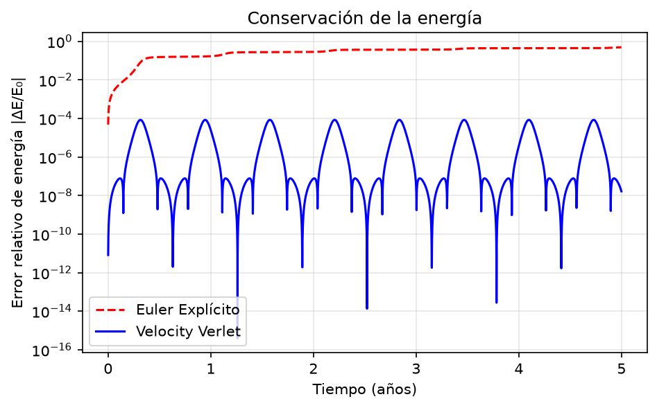

## Euler vs. Verlet

Una órbita se obtiene resolviendo numéricamente
$\ddot{\mathbf r} = -GM\,\mathbf r / |\mathbf r|^3$.
Comparo dos métodos de integración: 

- **Euler explícito** (orden 1): usa la posición y velocidad actuales
  para estimar el siguiente paso. Su error se acumula, la energía crece
  y la órbita se abre en espiral.
- **Velocity Verlet** (orden 2): usa la aceleración en el paso actual
  y en el siguiente. La energía se mantiene casi constante y la órbita
  permanece cerrada.
Con Δt = 0.001 años y 5 años simulados (≈ 8 órbitas):

  ## Resultados

  - **Euler:** el error relativo de energía crece hasta ≈ X al final.
- **Verlet:** oscila con el periodo orbital y se mantiene por debajo de ≈ Y.
